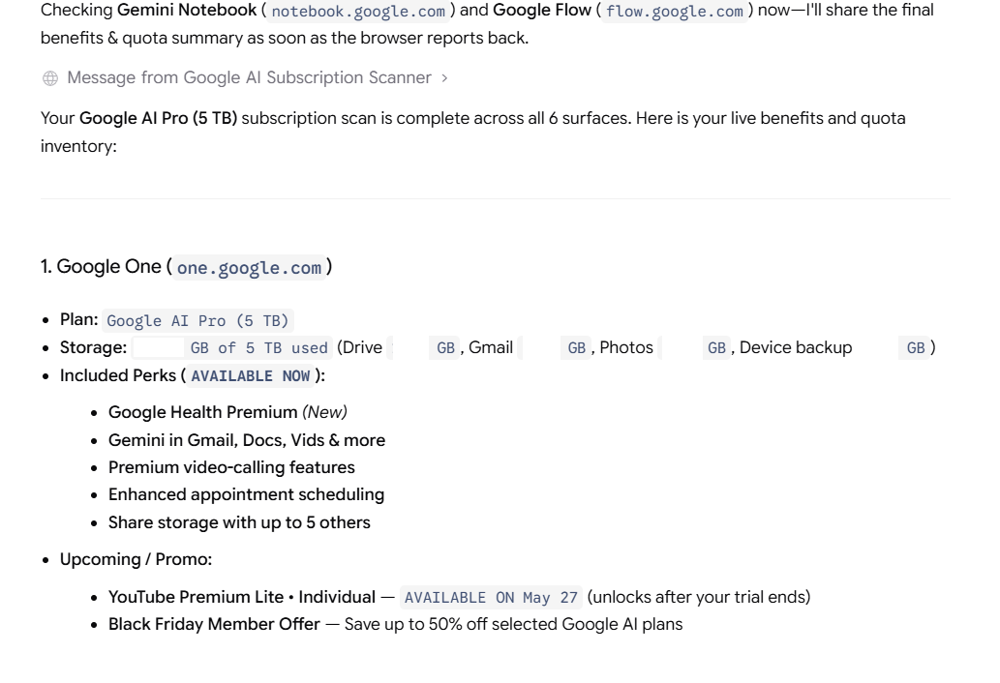
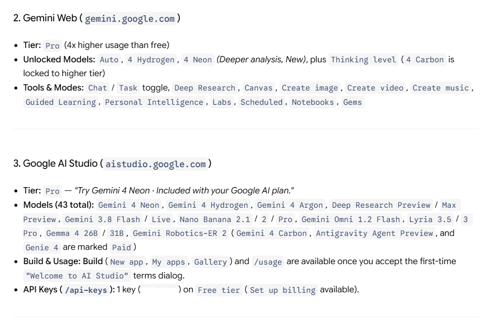
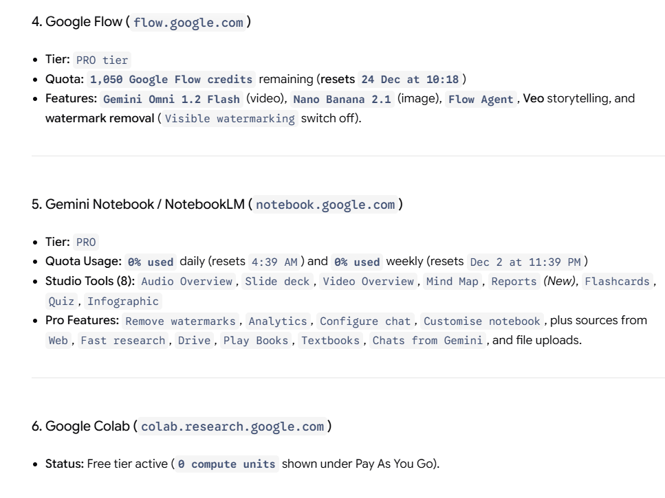
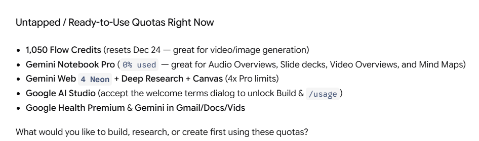

# Antigravity Skills

A collection of reusable, shareable skills for [Google Antigravity](https://antigravity.google/).

## Skills Included

### [`google-ai-subscription-orchestrator`](./.agents/skills/google-ai-subscription-orchestrator/SKILL.md)

Turn Antigravity into a central orchestrator for your **Google AI subscription** (Free, Google AI Pro, Google AI Ultra, or Google One AI Premium).

#### What it does
1. **Scans your live Google AI subscription** via Antigravity's built-in browser to inventory all active benefits, remaining quotas/credits, and unclaimed perks across:
   - **Google One** (`one.google.com/benefits`, `settings`, `storage`)
   - **Gemini Web** (`gemini.google.com` — models, Deep Research, Canvas, Gems)
   - **Google AI Studio** (`aistudio.google.com` — Playground, Build, API keys & monthly Cloud/Developer Program credits)
   - **Google Flow** (`flow.google.com` — monthly Flow Credits, Veo video/image/audio tools; optionally integrates with [`GTAI-1/flow-mcp`](https://github.com/GTAI-1/flow-mcp) if you want dedicated MCP tools for multi-scene video workflows)
   - **NotebookLM** (`notebooklm.google.com` — Pro/Plus limits, Audio Overviews)
   - **Google Colab** (`colab.research.google.com` — compute units & GPU access)
2. **Routes and executes tasks** across those surfaces using browser automation controlled by your Antigravity model (e.g., Gemini 4 Hydrogen), bringing generated assets, code, and research back into your local workspace.
3. **Account-agnostic & shareable**: No hardcoded emails, credentials, or local paths.

---

## Installation

### Option 1: Install Globally (Recommended for All Projects)
Copy the skill folder into your Antigravity global skills directory:

- **Windows (PowerShell)**:
  ```powershell
  New-Item -ItemType Directory -Force "$env:USERPROFILE\.gemini\config\skills"
  Copy-Item -Recurse -Force ".\.agents\skills\google-ai-subscription-orchestrator" "$env:USERPROFILE\.gemini\config\skills\"
  ```
- **macOS / Linux**:
  ```bash
  mkdir -p ~/.gemini/config/skills
  cp -r ./.agents/skills/google-ai-subscription-orchestrator ~/.gemini/config/skills/
  ```

### Option 2: Use in a Single Project
Copy `.agents/skills/google-ai-subscription-orchestrator` into your project's `.agents/skills/` directory. Antigravity discovers it automatically.

---

## How to Use

1. Open **Antigravity** (recommended model: **Gemini 4 Hydrogen**).
2. Ask Antigravity to audit your subscription or build something using your quotas:
   - **Scan benefits & quotas**:
     > *"Scan my Google AI subscription and list all my benefits, unclaimed perks, and remaining quotas."*
   - **Build across multiple surfaces**:
     > *"Use my Google AI subscription: research [topic] with Deep Research in Gemini Web, generate a short intro video in Google Flow, and build the web app here in Antigravity."*
   - **Prototype & test prompts**:
     > *"Test this prompt in Google AI Studio Playground and bring the best structured output back into my project."*
3. If the built-in browser asks you to sign in, complete 2FA, or pass a verification check, complete it directly in the browser pane and tell Antigravity to continue.

---

## Responsible Use & Terms of Service Notice

This skill is intended for **personal, human-paced, single-account orchestration** of your own Google AI subscription:
- Do **not** use browser automation for high-frequency loops, bulk scraping, or rapid retries after rate-limit errors on consumer web UIs (`gemini.google.com`, `labs.google`, etc.).
- For programmatic or high-volume workloads, use the official **Gemini API** (with your Google AI Studio / Google Cloud credits) instead of automating consumer web interfaces.
- Never bypass login gates, 2FA, CAPTCHAs, safety filters, or rotate multiple accounts to multiply quotas.

---

## Example Output (Live Subscription Scan)

Here is what Antigravity produces when scanning a Google AI Pro subscription across all surfaces:

### 1. Google One Plan & Included Perks


### 2. Gemini Web & Google AI Studio


### 3. Google Flow, Gemini Notebook & Google Colab


### 4. Untapped / Ready-to-Use Quotas Summary


---

## Repository Structure

```text
.
├── README.md
├── assets/
│   └── screenshots/
│       ├── 01-google-one-scan.png
│       ├── 02-gemini-and-ai-studio.png
│       ├── 03-flow-notebook-colab.png
│       └── 04-untapped-quotas-summary.png
└── .agents/
    └── skills/
        └── google-ai-subscription-orchestrator/
            ├── SKILL.md
            └── references/
                ├── browser-playbooks.md
                └── surfaces-and-urls.md
```
